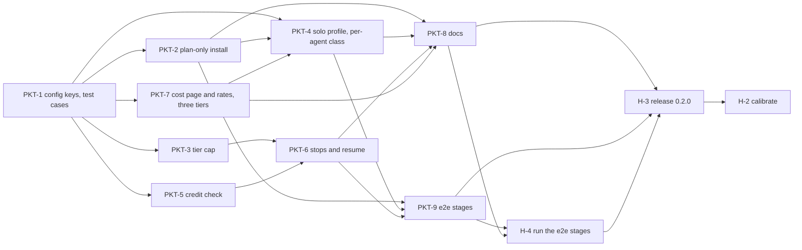

# Solo budget: plan-only mode, a solo profile and a credit ceiling

2026-10-31 · makes the kit usable on one seat's GitHub AI Credits (Pro 1,500, Business 1,900, Enterprise 3,900 a month): a plan-and-board-only install, a `solo` review profile, a per-packet credit ceiling, and a cost page recalculated for three tiers on the shipped models, cut into task packets that can be built in parallel.

- **Source plan:** the owner's request of 2026-10-26 (workstreams 1 to 4) and their answers of 2026-10-31, built on [docs/cost.md](../../cost.md) (levers, the budget profile, lean change #8). The decisions, cost workings and risks are in [review-notes.md](review-notes.md).

## Goal and constraints

Done means:

- `install.ps1 -PlanOnly` installs packet-plan, packet-board and packet-progress alone, and the README says how to hand a synced packet to a person or to the Copilot coding agent.
- `install.ps1 -Profile solo` starts a repository on a profile that puts a typical packet at about 1,000 credits on the cost page's method, with GPT-6.1 Sol in every class. The profile is:
  - two rounds;
  - three lenses per reviewer run;
  - should-fix-only rounds pass only in the last round (`shouldFixPassFromRound` 2);
  - a tier cap of 2, which machinery, the project's deep and max paths and a few others still override to tier 3;
  - the dispatcher on the standard class.
- `budget.maxCreditsPerPacket` stops a packet at Needs human before the round or fix run that would pass it, and `resume` carries on from the owner's answer.
- docs/cost.md and the default `budget.creditsPerRun` are recalculated for three tiers on GPT-6.1 Sol, and a human task replaces those estimates with measurements.

Constraints every packet lives with:

- **The four safety properties hold:** the tier is a floor (amended: under a cap, the forced raises still reach the top tier), markers count only from trusted authors, CI passes on the reviewed head, and only the owner merges.
- **Opt-in only.** An install whose config sets none of `review.tierCap`, `budget.maxCreditsPerPacket` and `models.agents` behaves as 0.1.1 does, with three deliberate exceptions the changelog names: every dispatch runs `credit-check.ps1` at Select, before each round and before each fix run (it prints OFF after reading only the config when no ceiling is set); a reviewer the host won't start stops the round at Needs human; and a packet Target that is a day that doesn't exist, such as `2026-11-00`, is now an error in validate-packets and board sync, and stops `progress.ps1` with exit 2 and a message naming the packet, where 0.1.1's progress.ps1 crashed on it (PKT-1). A config that leaves out `budget.creditsPerRun`, or part of it, also gets PKT-7's new default rates. Every one of the 243 offline tests at 0.1.1 passes unchanged, except the credit figures PKT-7 re-pins to the new default rates. An existing config keeps the `creditsPerRun` written in it.
- **Offline and cross-platform.** Every new behaviour has offline tests (pwsh 7.2+ and git only), which CI runs on Linux, macOS and Windows.
- **Settings come from the base.** The cap and the ceiling are read like the existing review limits: from the config at the base, never from the branch under review.
- **Built without the kit.** The owner decided the phase isn't dispatched. Each packet is one PR, built by a person or an assistant and reviewed by the owner. Its **Review lenses** and **Review tier** lines say what that review should cover; its Dispatcher notes are notes for whoever builds it.
- `VERSION` and `CHANGELOG.md` change only in the release PR (H-3), as CONTRIBUTING.md says.

## Milestones

| When | Exit | Proven by |
| --- | --- | --- |
| 2026-11-04 | the new keys load with defaults that change nothing; packets add tests as files of their own | PKT-1 |
| 2026-11-09 | a plan-only install plans, syncs and reports offline; the cap and the credit check work from the scripts; the cost page and the default rates are on GPT-6.1 Sol | PKT-2, PKT-3, PKT-5, PKT-7 |
| 2026-11-12 | `-Profile solo` installs; a dispatch stops at the ceiling or at a refused reviewer and resumes | PKT-4, PKT-6 |
| 2026-11-19 | docs, the e2e stages run on a sandbox, and the 0.2.0 release | PKT-8, PKT-9, H-4, H-3 |
| 2026-12-04 | `budget.creditsPerRun` measured on Copilot-hosted models | H-2 |

## Packets

Priority: **P0** the phase fails without it; **P1** planned; **P2** behind the cut line (stays in Backlog until promoted).

| Packet | Title | P | Size | Wave | Depends on | Review lenses |
| --- | --- | --- | --- | --- | --- | --- |
| PKT-1 | Add the new config keys and a test-case folder | P0 | M | W0 | – | architecture, correctness, tests |
| PKT-2 | Install only the plan, board and progress skills | P0 | M | W1 | PKT-1 | ops, correctness, tests |
| PKT-3 | Cap the review tier except where the top tier is forced | P0 | M | W1 | PKT-1 | security, architecture, correctness, tests |
| PKT-4 | Add the solo profile and a model class per agent | P0 | M | W2 | PKT-1, PKT-2, PKT-7 | ops, correctness, tests |
| PKT-5 | Check a packet's estimated credits against a ceiling | P0 | M | W1 | PKT-1 | security, integration, correctness, tests |
| PKT-6 | Stop at the credit ceiling or a refused reviewer | P0 | M | W2 | PKT-3, PKT-5 | security, architecture, correctness, tests |
| PKT-7 | Recalculate the cost page and default rates for three tiers | P0 | M | W1 | PKT-1 | correctness, tests |
| PKT-8 | Document plan-only mode, the solo profile and the ceiling | P1 | M | W3 | PKT-2, PKT-4, PKT-6, PKT-7 | security, correctness |
| PKT-9 | Add e2e stages for plan-only, solo and the ceiling | P1 | S | W3 | PKT-2, PKT-4, PKT-6 | correctness, tests |

Human tasks: H-2 Calibrate credits per run on Copilot-hosted models (workstream 4); H-3 Release the phase as 0.2.0; H-4 Run the new e2e stages on a sandbox.

Each packet file in `packets/` is the source of truth for its scope; the board item is generated from it
(`board.ps1 sync`) and holds its state. This table is an index.

## Dependency graph

**Critical path:** PKT-1 → PKT-2 → PKT-4 → PKT-8 → H-4 → H-3 → H-2, weight 11 (from `validate-packets.ps1`, which reports 0 errors and 0 warnings for this phase). The chains into PKT-8 through PKT-7 → PKT-4, PKT-3 → PKT-6 and PKT-5 → PKT-6 weigh the same, and PKT-1 → PKT-2 → PKT-4 → PKT-9 → H-4 → H-3 one less, so a slip in any of them, PKT-9 and H-4 included, moves the release. Land PKT-1 first and fast: five packets wait on it.

## Schedule

A packet's **wave** is when it can start (its dependencies' waves are earlier); its **target** is when it should reach Ready to merge.

| Wave | Starts | Packets | Owner's part |
| --- | --- | --- | --- |
| W0 | 2026-11-02 | PKT-1 | Review and merge it as soon as it is done: five packets wait on it. |
| W1 | 2026-11-04 | PKT-2, PKT-3, PKT-5, PKT-7 | Four PRs in parallel. Review PKT-3 and PKT-5 most closely: they change what the panel and the budget let through. |
| W2 | 2026-11-09 | PKT-4, PKT-6 | Two PRs. Review PKT-6 most closely. |
| W3 | 2026-11-12 | PKT-8, PKT-9 | Then H-4 (run the e2e stages), H-3 (release) and H-2 (calibration). |

## Keeping parallel agents out of each other's way

1. **Contracts first.** PKT-1 lands the keys, their defaults and checks, `Get-PwCreditCeiling`, `Get-PwAgentModelClass`, the kit's lens list and the `tests/cases/` folder. Later packets code against those names. Only PKT-7 touches `PacketWorkflow.ps1`, the default template or `tests/run-tests.ps1` again, and only for the credit rates and progress's rule for a finished packet.
2. **Each packet owns paths.** Its Owns list is the only place its builder edits. Files that two packets need are owned in turn, through dependencies:
   - `PacketWorkflow.ps1`, `templates/packet-workflow.json` and `tests/run-tests.ps1`: PKT-1, then PKT-7;
   - `install.ps1`: PKT-2, then PKT-4;
   - `skills/packet-review/SKILL.md` and its round report template: PKT-3, then PKT-6;
   - `README.md`: PKT-2, then PKT-8;
   - `docs/cost.md`: PKT-7, then PKT-8.
3. **No shared touchpoints.** `tests/run-tests.ps1` would have been the one every packet edits; PKT-1 makes each packet's tests a file of its own under `tests/cases/` instead.
4. **Locks.** None: the phase has no migrations, lockfiles or generated clients.
5. **One decision record per packet** in `docs/decisions/solo-budget/<ID>.md`, so parallel PRs never edit one file.
6. **Fakes first.** The board runs on the `local` provider and GitHub calls are stubbed, as the existing suite does, so every packet builds and tests offline.

## Shared touchpoints

None. A packet that finds it needs a file another packet owns stops and asks the owner; it doesn't add a touchpoint.

## Cut line and fallbacks

- **Behind the cut line if the schedule slips:**
  - PKT-9, the e2e stages: the offline tests still cover the scripts. H-4 goes with it, H-3 drops both dependencies, and the release notes say the e2e stages haven't run.
  - PKT-3's `ModelCheck` field: the installer's warning in PKT-4 and the stop in PKT-6 still cover the Local harness.
- **If PKT-6 slips:** release plan-only mode and the solo profile without the ceiling. `credit-check.ps1` (PKT-5) can still be run by hand, and the solo profile works without it.
- **If PKT-3 slips:** the solo template ships without `tierCap`. An M packet's two rounds then run at tier 3: about 1,290 credits against 985 with the cap.
