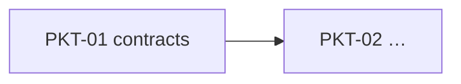

# <Phase name>

Date · one line on what this phase delivers, cut into task packets that agents build in parallel.

<!-- The heading is the phase's name on the board (the GitHub milestone). Optional lines, filled in by
     the owner, not by sync: "- **Board:** <link>" and "- **Epic:** #<n>" (or AB#<n>) naming an issue or work
     item that already exists; sync then makes each packet its sub-issue or child. Leave them out otherwise. -->
- **Source plan:** <link to the implementation plan this was cut from>

## Goal and constraints

What "done" means for the phase, the date it matters by, and the constraints every packet lives with
(for example: every merge to main deploys; an external API isn't approved yet; one person merges).

## Milestones

| When | Exit | Proven by |
| --- | --- | --- |
| <date> | <what works end to end> | PKT-01, PKT-04, H-1 |

## Packets

Priority: **P0** the phase fails without it; **P1** planned; **P2** behind the cut line (stays in Backlog until promoted).

| Packet | Title | P | Size | Wave | Depends on | Review lenses |
| --- | --- | --- | --- | --- | --- | --- |
| PKT-01 | Core contracts | P0 | M | W0 | – | architecture, correctness, tests |

Human tasks: H-1 <title>.

Each packet file in `packets/` is the source of truth for its scope; the board item is generated from it
(`board.ps1 sync`) and holds its state. This table is an index.

## Dependency graph

**Critical path:** PKT-01 → … (from `validate-packets.ps1`). Land the packets most others depend on first and fast.

## Schedule

A packet's **wave** is when it can start (its dependencies' waves are earlier); its **target** is when it should reach Ready to merge.

| Wave | Starts | Packets | Owner's part |
| --- | --- | --- | --- |
| W0 | <date> | PKT-01 | Merge PKT-01 as soon as it passes. |

## Keeping parallel agents out of each other's way

1. **Contracts first.** <Which packet lands the shared types, interfaces and fakes.>
2. **Each packet owns paths.** Its Owns list is the only place its implementer edits, apart from the shared touchpoints below.
3. **Shared touchpoints get small, additive edits only** (the table below; the validator checks every packet against it).
4. **Locks.** <Which exclusive resources exist (migrations, a lockfile, a shared schema) and which packet holds each.>
5. **One decision record per packet** in `docs/decisions/<phase>/<ID>.md`, so parallel PRs never edit one file.
6. **Fakes first.** External services sit behind interfaces with fakes or recorded fixtures, so every packet builds and tests offline.

## Shared touchpoints

| File | Allowed edit |
| --- | --- |
| `src/App/Program.cs` | One `AddX()` and one `MapX()` line; the wiring lives in the packet's own extension method. |

Conflicts there are resolved by merging the default branch into the packet branch; never rebase and force-push.

## Cut line and fallbacks

What moves behind the cut line if the schedule slips, and what the phase falls back to.
